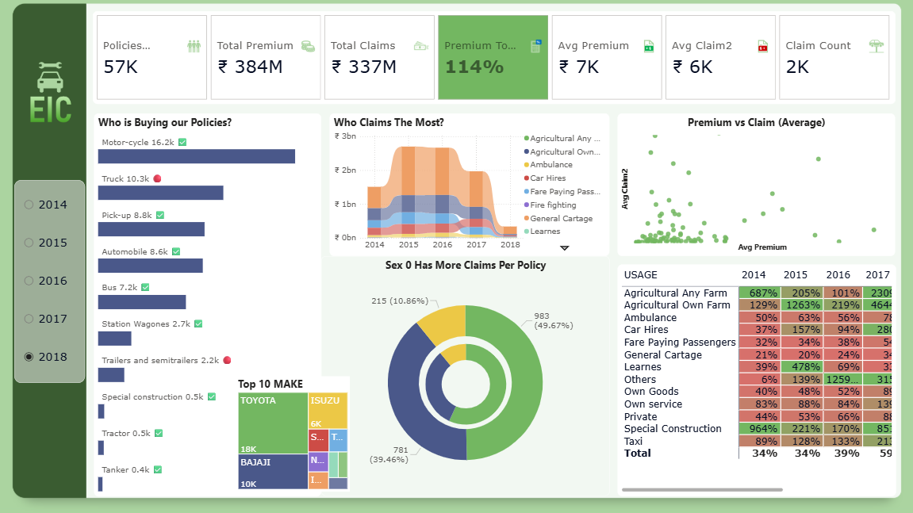

# 🚗 Motor Insurance Analytics Dashboard (Power BI)

An interactive **Power BI** dashboard analysing **508,499 motor-insurance policies (2014–2018)**. It answers three business questions: *who buys the policies, who claims the most, and is each segment profitable?*



## 📌 Highlights

| KPI | Value (all years) |
|---|---|
| Policies | 508,499 |
| Total premium | 4.04 B |
| Total claims paid | 9.18 B |
| Premium-to-claims ratio | **44 %** |
| Avg premium / policy | ~7.9 K |
| Avg claim / policy | ~18.1 K |
| Policies with a claim | 37,772 (7.4 %) |

> Premium-to-claims ratio = Total premium ÷ Total claims. Below 100 % means claims exceeded premiums collected.

## 🔍 Key insights

- **Motorcycles dominate volume** (~106K policies) but have the lowest claim frequency (0.5 %).
- **Trucks, buses and pick-ups** carry most of the premium and claim cost.
- **Policyholder group `SEX = 0` files more claims per policy** (9.7 % vs 5.2 % for group 1).
- **Claims exceed premium in every year up to 2017** (ratio 34 % → 59 %). The 114 % ratio shown for 2018 is **not a real improvement**: 2018 is a partial year and its claims are still maturing.
- **Agricultural, special-construction and taxi usage** show very high ratios on small bases; treat with care.

Full numbers are in [`docs/insights.md`](docs/insights.md).

## 🧰 Dashboard features

- 7 KPI cards (policies, premium, claims, ratio, averages, claim count)
- Year slicer (2014–2018) that filters the whole page
- Policies by vehicle type, claims trend by usage (ribbon chart), top 10 makes (treemap)
- Claims split by policyholder group (donut), premium vs claim scatter
- Heat-mapped premium-to-claims matrix by usage × year
- Custom tooltip page ([preview](assets/screenshots/tooltip.png))
- Custom "City Park" theme, custom backgrounds and icons

## 📁 Repository structure

```
motor-insurance-powerbi-dashboard/
├── powerbi/
│   └── Motor_Insurance_Dashboard.pbix     # main report
├── data/
│   ├── raw/motor_data14-2018.csv.gz       # source dataset (gzipped, 508K rows)
│   └── reference/Calendar.xlsx            # date dimension (2014-07-01 onward)
├── assets/
│   ├── screenshots/                       # dashboard + tooltip previews
│   └── images/                            # icons, backgrounds, logos used in the report
├── docs/
│   ├── data_dictionary.md
│   └── insights.md
├── scripts/profile_data.py                # reproduces KPIs outside Power BI
├── requirements.txt
├── LICENSE
└── README.md
```

## 🚀 Getting started

1. Install [Power BI Desktop](https://powerbi.microsoft.com/desktop/) (Windows).
2. Open `powerbi/Motor_Insurance_Dashboard.pbix`. The data is embedded, so it opens without setup.
3. To **refresh from source**: unzip `data/raw/motor_data14-2018.csv.gz`, then in Power BI go to *Transform data → Data source settings* and point the `policies` and `calendar` sources at the unzipped CSV and `data/reference/Calendar.xlsx`.

### Verify the numbers with Python

```bash
pip install -r requirements.txt
python scripts/profile_data.py
```

## 🧮 Data model

| Table | Source | Role |
|---|---|---|
| `policies` | `motor_data14-2018.csv` | Fact table (one row per policy period) |
| `calendar` | `Calendar.xlsx` | Date dimension (Year, Month, Quarter, QY) |

Measures in the report: `Policies Opened`, `Policies Closed`, `Total Premium`, `Total Claims`, `Premium To Claims Ratio`, `Avg Premium`, `Avg Claim`, `Avg Claim2`, `Claim Count`, `ToolTip Header`.

See [`docs/data_dictionary.md`](docs/data_dictionary.md) for every column.

## ⚠️ Data notes

- 78 exact duplicate rows, and missing values in `CLAIM_PAID` (93 % blank = no claim), `CARRYING_CAPACITY`, `PREMIUM` and a few other columns.
- Year is derived from `INSR_BEGIN`; the dataset ends in 2018, so 2018 is incomplete.
- The report formats amounts with the ₹ symbol. The dataset appears to originate from an Ethiopian insurer (the report logo reads "EIC"), so the underlying currency is likely not INR. Change the measure format if you want a neutral label.
- The dataset is publicly available; check the original source's licence before redistributing it.

## 🛠️ Tech stack

Power BI Desktop · DAX · Power Query · Excel · Python (pandas) for validation

## 👤 Author

**Darshan**: [GitHub @Darshan-2006](https://github.com/Darshan-2006)

Licensed under the [MIT License](LICENSE) (code and report). Dataset terms belong to its original publisher.
